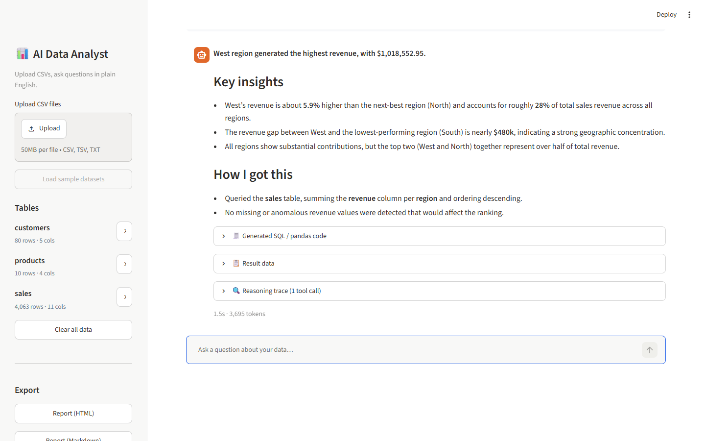
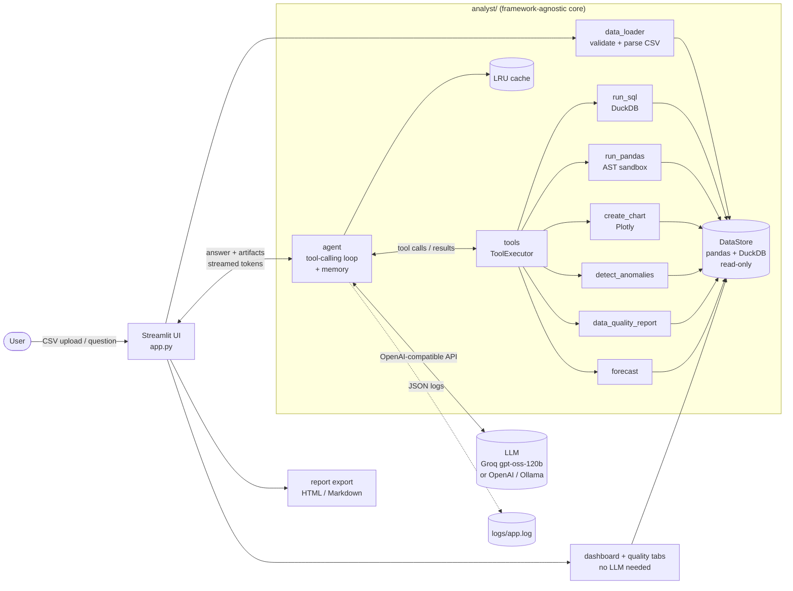
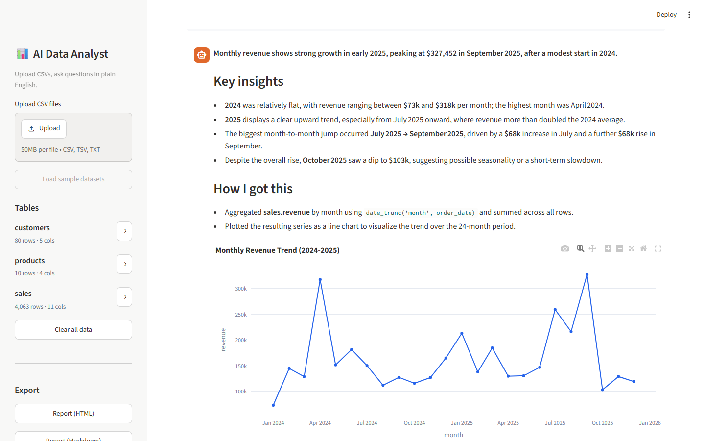
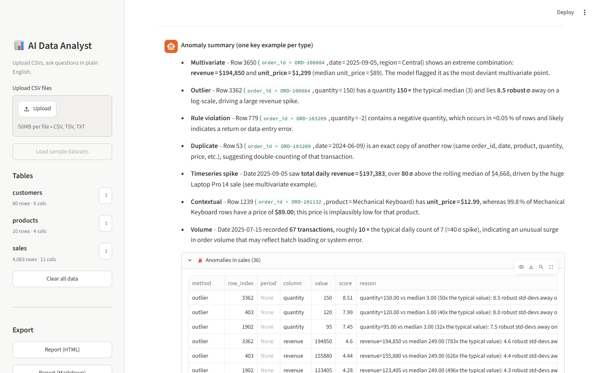
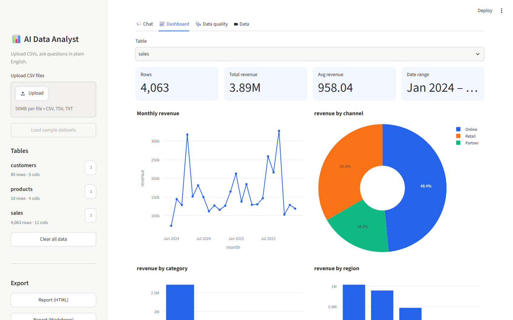
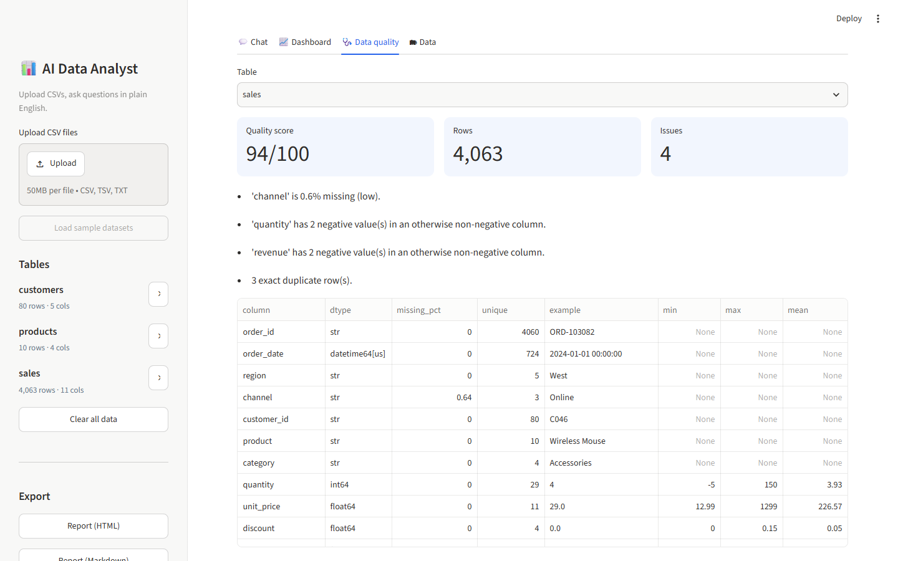

# 📊 AI Data Analyst

Upload one or more CSV files and ask questions in plain English. The analyst **writes and runs SQL / pandas against your data**, builds **charts**, flags **anomalies with explanations**, runs **data-quality checks** and **forecasts**, and explains **how it reached every answer**, all while remembering the conversation.

Built for the Digital Back Office *AI Engineer Assignment*. The aim was a production-shaped AI application: the LLM is grounded by tools and never asked to make up numbers.

> 🎥 **Demo video (29 s):** [`docs/demo.mp4`](docs/demo.mp4)  ·  🌐 **Live app:** _add your Streamlit Cloud URL here_  ·  ✅ **Evals:** 9/9 passed, ~4.5 s avg latency (`openai/gpt-oss-120b` on Groq)



---

## Features

| Requirement | How it is met |
|---|---|
| Upload & validate one or more CSVs | Encoding detection (UTF-8/CP1252/Latin-1), delimiter sniffing (`, ; \t \|`), size & file-count limits, empty/headerless file rejection, snake_case column normalisation, duplicate-name handling, auto-parsing of dates and `"$1,200"`/`"12%"` text-numbers, with warnings shown to the user |
| Natural-language Q&A | Tool-calling agent (LLM ↔ tools loop) grounded in the live schema of every table |
| Business insights & summaries | Answer format enforces a direct answer + **Key insights** (comparisons, %, trends) |
| Charts (bar, line, pie, scatter, area, histogram, box) | `create_chart` tool: the LLM supplies a SQL query + chart spec, so the chart is drawn from real data, then rendered with Plotly |
| SQL and/or pandas generation | `run_sql` (DuckDB) and `run_pandas` (sandboxed) tools; every query is shown in the UI and kept in memory so *"Generate SQL for this analysis"* works as a follow-up |
| Anomaly detection with explanations | Deterministic, explainable detectors (see below); each anomaly carries a human-readable reason |
| Explain reasoning | Every answer ends with **How I got this**, and the UI shows a step-by-step **reasoning trace** (tool, arguments, timing, result preview) |
| Conversation context | Last *N* turns, plus the SQL/code that produced each answer, are replayed to the model |

**Bonus features implemented:** multi-file analysis (SQL joins across uploaded files) · auto-generated dashboard · data-quality checks with a 0-100 score · forecasting (trend + seasonality with an 80% interval) · agentic workflow with tool calling and self-correction · answer caching · report export (HTML / Markdown) · streaming responses · structured JSON observability logs · evaluation framework · Docker · CI.

---

## Architecture



**Request lifecycle**

1. The **system prompt** is built from the live schema (tables, columns, types, ranges, sample values, null counts).
2. The LLM decides which **tools** to call. Tool results go back to the model; **errors** are returned as text so it can fix a wrong column name and retry (self-correction).
3. The loop is capped at `MAX_TOOL_STEPS`. If the cap is hit, the model must answer from the results it already has.
4. The final answer streams to the UI along with its **artifacts**: charts, SQL/code, result tables, anomaly tables and the step trace.
5. The answer and its SQL are stored in **conversation memory**. The full response is cached under *(data fingerprint, context, normalised question)*.

### Project layout

```
app.py                     Streamlit UI (chat, dashboard, data quality, data preview)
analyst/
  config.py                env-driven settings
  data_loader.py           CSV validation/parsing, DataStore, SQL safety
  agent.py                 tool-calling loop, prompt, memory, caching
  llm.py                   OpenAI-compatible streaming client + error mapping
  tools.py                 tool schemas + executor (returns text for LLM, artifacts for UI)
  sandbox.py               AST-validated pandas execution
  anomaly.py               explainable anomaly detectors
  quality.py               data-quality profiling and score
  forecast.py              OLS trend + monthly seasonality forecast
  charts.py / dashboard.py Plotly charts, automatic dashboard
  report.py                HTML / Markdown export
  cache.py                 thread-safe LRU cache
  logging_setup.py         JSON-lines logging, timing context manager
tests/                     62 offline tests (fake LLM, no network)
evals/run_evals.py         live benchmark with data-derived ground truth
sample_data/               sales, customers, products (+ generator script)
scripts/                   sample-data generator, smoke test, screenshot/video capture
```

---

## Quick start

### Option A: Docker (recommended)

```bash
cp .env.example .env          # add your GROQ_API_KEY (free: https://console.groq.com/keys)
docker compose up --build
# open http://localhost:8501
```

### Option B: Local Python (3.10+)

```bash
python -m venv .venv
# Windows: .venv\Scripts\activate    macOS/Linux: source .venv/bin/activate
pip install -r requirements.txt
cp .env.example .env          # add your GROQ_API_KEY
streamlit run app.py
```

Click **Load sample datasets** in the sidebar, or upload your own CSVs, then try the suggested questions.

> No API key? The **Dashboard** and **Data quality** tabs (including anomaly scan) still work. They don't need an LLM.

### Switching LLM provider

Any OpenAI-compatible endpoint works through `.env`, for example OpenAI (`LLM_BASE_URL=https://api.openai.com/v1`, `LLM_MODEL=gpt-4o-mini`) or a local Ollama model. See [.env.example](.env.example).

---

## Testing & evaluation

```bash
pip install -r requirements-dev.txt
pytest                      # 62 offline tests, ~10 s, no API key needed
python evals/run_evals.py   # live benchmark against the LLM (needs a key)
```

**Unit/integration tests** cover CSV validation edge cases (encodings, delimiters, currency text, empty/oversized files), SQL safety (DDL/DML, multi-statement, filesystem functions), sandbox escapes (imports, dunders, `open`, file I/O), every anomaly detector (including no false positives on clean data), quality scoring, forecasting, every chart type, the agent loop with a scripted fake LLM (tool → answer, memory, self-correction after tool errors, step cap, malformed tool-call retry, LLM error handling, caching) and report export.

**The evaluation framework** asks the assignment's example questions (plus a join, a forecast and an off-topic question). Expected answers are **computed from the data with pandas**, so they stay correct if the data changes. Each answer is scored on correct facts, correct tool use and required artifacts. Pass rate, latency and tokens are written to `evals/results.json`.

Latest run (`openai/gpt-oss-120b` via Groq): **9/9 passed**, ~4.5 s average latency, ~45k tokens for the whole suite. Iterating against this benchmark drove several fixes: a deterministic chart fallback when the model only runs a query, pre-computed anomaly impact figures so the model never estimates them, row ids in anomaly context, and retrying malformed tool calls.

---

## Anomaly detection: how anomalies are found and explained

Anomalies are computed **deterministically**, not by the LLM, so they are reproducible. The LLM's job is to explain them in business terms. Detectors:

| Detector | Method | Example reason |
|---|---|---|
| Outlier | Modified z-score (median/MAD) on a log scale for skewed data, cut at the largest **natural break** in the tail so that a long tail of legitimate large orders isn't flagged | *quantity=150 vs median 3 (50x the typical value): 8.5 robust std-devs away* |
| Contextual | A value that breaks an otherwise-fixed relationship inside a group | *unit_price=12.99 for product='Mechanical Keyboard', but 99.8% of its rows have 89.00* |
| Rule | Negative values in an otherwise non-negative column; exact duplicate rows | *quantity=-5 is negative while 99.95% of values are non-negative* |
| Time series / volume | Daily total and daily record count vs a rolling median | *Number of records on 2025-07-15 was 67 vs a typical 7 (spike)* |
| Multivariate (opt-in) | IsolationForest, explained by the most deviant features | *Unusual combination: revenue=…, quantity=…* |

The sample data contains **deliberately injected anomalies**, and the test suite checks that all of them are found: 3 bulk orders, 2 negative quantities, a mis-keyed unit price, a flash-sale spike on 2025-07-15, 3 duplicate rows and 25 missing `channel` values.

---

## Sample datasets (`sample_data/`)

| File | Rows | Description |
|---|---|---|
| `sales.csv` | 4,063 | Order lines, Jan 2024 – Dec 2025: date, region, channel, customer, product, category, quantity, unit price, discount, revenue. Includes seasonality (Q4 peak), growing and **declining products** (Tablet 10, Webcam HD) and the injected anomalies above |
| `customers.csv` | 80 | Customer master: name, segment, country, signup date (join on `customer_id`) |
| `products.csv` | 10 | Catalogue: category, list price, unit cost (join on `product` for margin analysis) |

Regenerate with `python scripts/generate_sample_data.py` (deterministic seed).

---

## Screenshots

| | |
|---|---|
|  |  |
|  |  |
|  | |

---

## Design decisions & assumptions

- **Tools over free-form generation.** The LLM never computes numbers itself. It writes SQL/pandas, which run on the real data, and its answer must be grounded in those results. This is the main defence against hallucinated figures.
- **DuckDB for SQL.** Fast in-process analytical SQL directly over pandas DataFrames, with no database server. Only single `SELECT` statements are allowed: they are validated with DuckDB's own parser, and `enable_external_access=false` is set so SQL can't touch the filesystem or network.
- **Sandboxed pandas.** Code is AST-checked (no imports, dunders, `open`/`eval`/`getattr` or file I/O methods) and runs with whitelisted builtins on *copies* of the data.
- **Provider-agnostic LLM layer.** It uses the OpenAI Chat Completions protocol, so Groq, OpenAI, Ollama and vLLM are a config change away. Groq's `openai/gpt-oss-120b` is the default because it's fast with a free tier. Provider errors (auth, rate limit, timeout, malformed tool calls) map to clear user-facing messages, and malformed tool calls are retried automatically.
- **Compact memory.** Raw tool payloads aren't replayed. Instead each past answer is stored with the SQL/code that produced it, which keeps prompts small but still supports follow-ups like *"Generate SQL for this analysis"* or *"now only for 2025"*.
- **Caching** is keyed on a hash of the loaded data plus recent context, so it can never serve an answer computed on different data.
- **Assumptions:** CSVs have a header row; each file fits in memory (default limit 50 MB per file, 10 files); "revenue/sales" means the money column (or quantity × price if none exists); sessions are single-user and in-memory.

## Limitations & next steps

- The pandas sandbox is a guard-rail, not a hardened security boundary. For an untrusted multi-tenant deployment, run tool execution in an isolated worker process/container with CPU/memory limits.
- Session state is in-memory (per browser tab). Persistent multi-user use would need auth and a store (e.g. Postgres/Redis) for sessions and the cache.
- Forecasting is intentionally lightweight (OLS trend + seasonality). Prophet/statsmodels could be plugged in behind the same tool interface.
- Very wide or very large datasets would benefit from schema retrieval (embedding column descriptions) rather than sending the full schema in the prompt.
